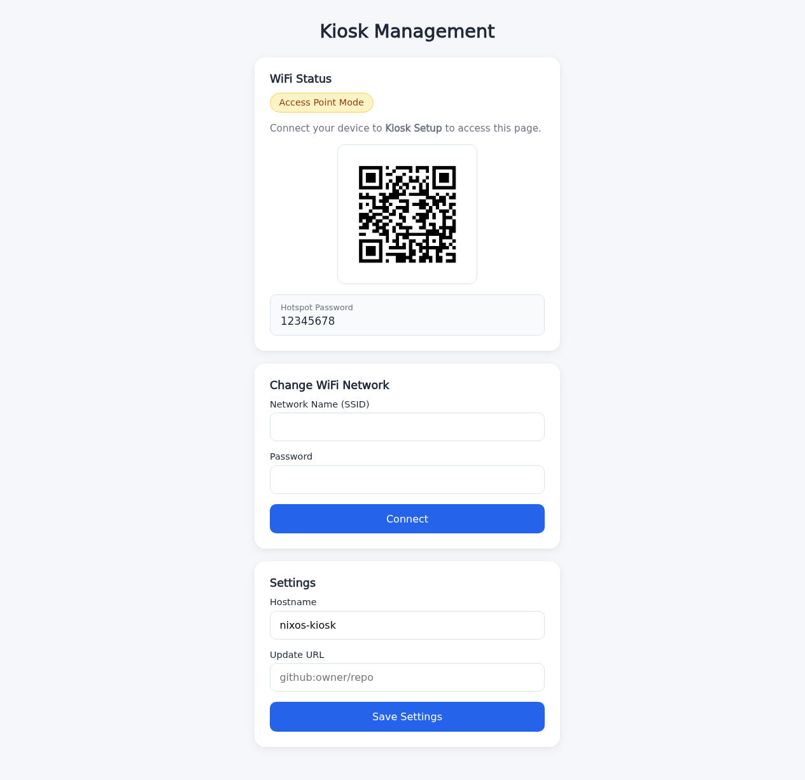

# NixOS Kiosk

**Create a Kiosk appliance with NixOS.**

This repo provides a few NixOS module to create an appliance kiosk.
It does not provide a full working system, it should be used
in a full-fledged NixOS configuration. See the [examples](examples/)
for integration examples.

Currently, it is tested exclusively for Raspberry Pi 3
with [github:ibizaman/nixos-raspberrypi](https://github.com/nvmd/nixos-raspberrypi). So usage with other systems might not work out of the box.
Feel free to open issues!

## Features

Each feature can be imported individually with modules.

- [Appliance module](#appliance): disables unneeded features.
- [Wifi module](#wifi): allow to setup WiFi connection at runtime.
- [Firstboot module](#first-boot-config): allow to configure some options without rebuilding the SD card.

### Appliance

Disables unneeded features on the host to reduce attack surface and disk and memory usage.

```nix
{
  imports = [ inputs.nixos-kiosk.nixosModules.appliance ];
}
```

- Disables nix on the host.
- Disables rebuilding the host.
- Users are static.
- Disables documentation.
- Removes Perl from default packages.

Uses [nixpkgs' image-based-appliance.nix profile](https://github.com/NixOS/nixpkgs/blob/master/nixos/modules/profiles/image-based-appliance.nix) under the hood.

### WiFi

Let's you setup the WiFi connection at runtime, after boot.

```nix
{
  imports = [ inputs.nixos-kiosk.nixosModules.wifi-setup ];
}
```

When no WiFi is configured the device acts as an access point and
displays a setup form where you can enter your network credentials.

Either configure the WiFi from the interface or use the QR Code
to connect your mobile device to the Access Point of the device
and configure it from there.



Upon WiFi connection, the device will auto-switch to display
a configured hardcoded URL.

The WiFi is still configurable even if the device is connected:


### First Boot Config

Let's you setup options after burning an image on an SD card.

```nix
{
  imports = [ inputs.nixos-kiosk.nixosModules.firstboot ];

  config = {
    kiosk.firstboot.enable = true;
  };
}
```

Enabling this module generates a file `/boot/firmware/kiosk.conf`
which you can tweak to configure the appliance before booting it
for the first time.

The default `kiosk.conf` file can be seen in [docs/kiosk.conf](docs/kiosk.conf).

## Usage

Follow the flakes in the examples/ folder.
See their respective README.md files for build commands.

## Develop

### Push to cachix

nix build .#nixosConfigurations.nixos-kiosk-rpi3.config.system.build.toplevel --no-link --print-out-paths | grep -v .zst- | nix run nixpkgs#cachix push ibizaman
nix build .#sdImages.nixos-kiosk-rpi3 --no-link --print-out-paths | grep -v .zst- | nix run nixpkgs#cachix push ibizaman
