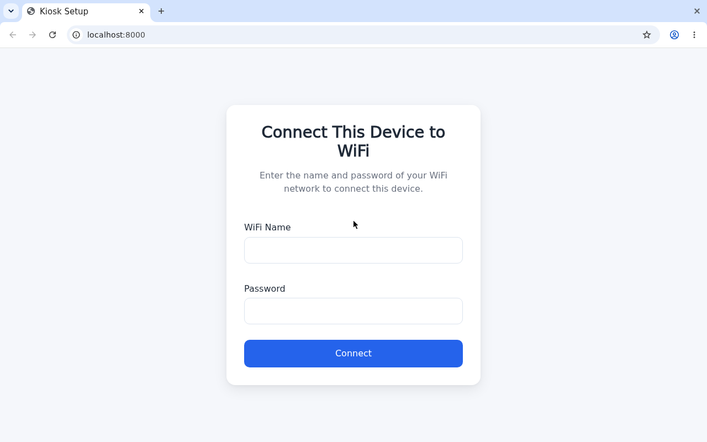
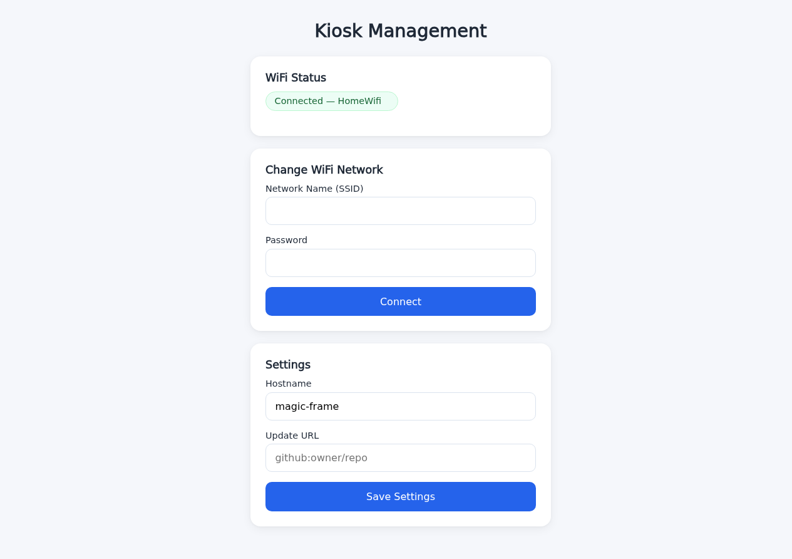

# NixOS Kiosk

**Create a Kiosk appliance with NixOS.**

This repo provides a few NixOS module to create an appliance kiosk.
It does not provide a full working system, it should be combined for example
with [github:ibizaman/nixos-raspberrypi](https://github.com/nvmd/nixos-raspberrypi).

## Features

When no WiFi is configured the device acts as an access point and
displays a setup form where you can enter your network credentials.

Either configure the WiFi from the interface or use the QR Code
to connect your mobile device to the Access Point of the device
and configure it from there.

Upon WiFi connection, the device will auto-switch to display
a configured hardcoded URL.

The WiFi is still configurable even if the device is connected:

## Usage

Follow the flakes in the examples/ folder.
See their respective README.md files for build commands.

## Develop

### Push to cachix

nix build .#nixosConfigurations.nixos-kiosk-rpi3.config.system.build.toplevel --no-link --print-out-paths | grep -v .zst- | nix run nixpkgs#cachix push ibizaman
nix build .#sdImages.nixos-kiosk-rpi3 --no-link --print-out-paths | grep -v .zst- | nix run nixpkgs#cachix push ibizaman
