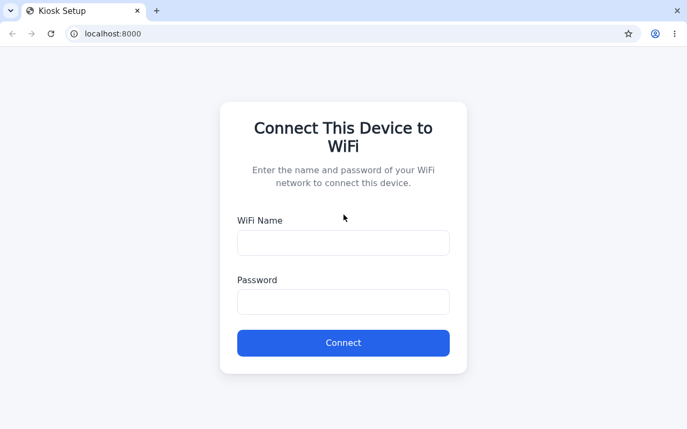

# Magic Kiosk

Create a Kiosk appliance with NixOS.

When no WiFi is configured the device acts as an access point and
displays a setup form where you can enter your network credentials:



## Setup

1. Build the sdcard image:

   ```bash
   nix build .#sdImages.nixos-kiosk-rpi3
   ```

2. Burn on sdcard:

   ```bash
   nix run nixpkgs#usbimager
   ```

3. Boot RPI

## Develop

### Push to cachix

nix build .#nixosConfigurations.nixos-kiosk-rpi3.config.system.build.toplevel --no-link --print-out-paths | grep -v .zst- | nix run nixpkgs#cachix push ibizaman
nix build .#sdImages.nixos-kiosk-rpi3 --no-link --print-out-paths | grep -v .zst- | nix run nixpkgs#cachix push ibizaman
