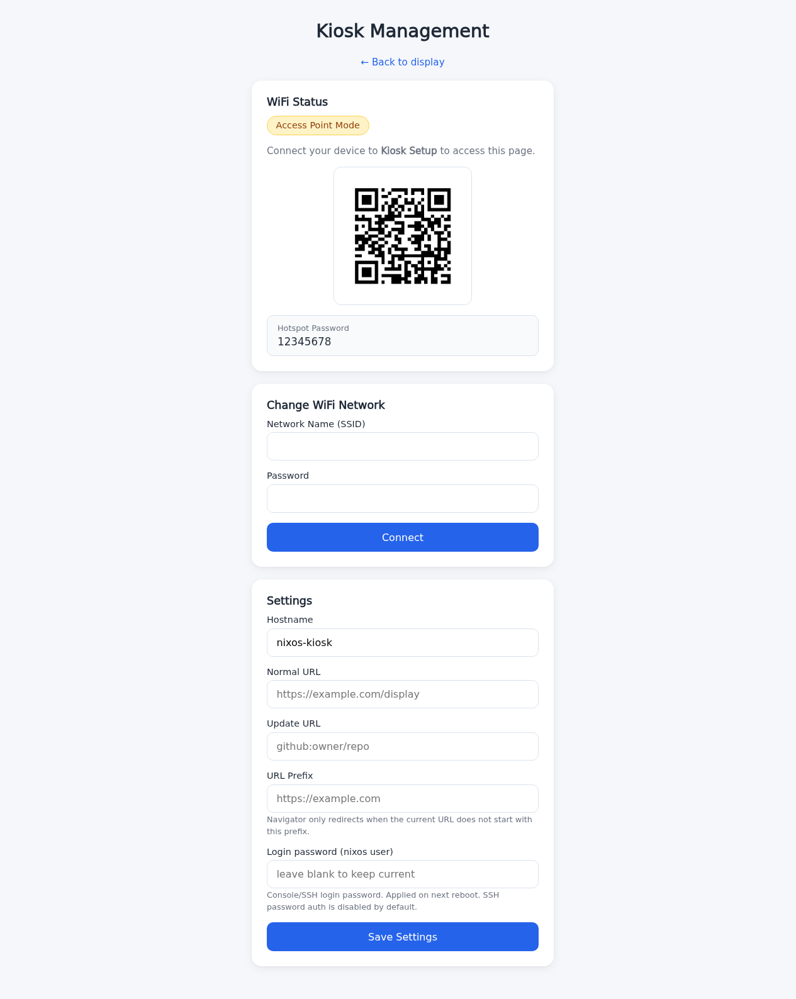
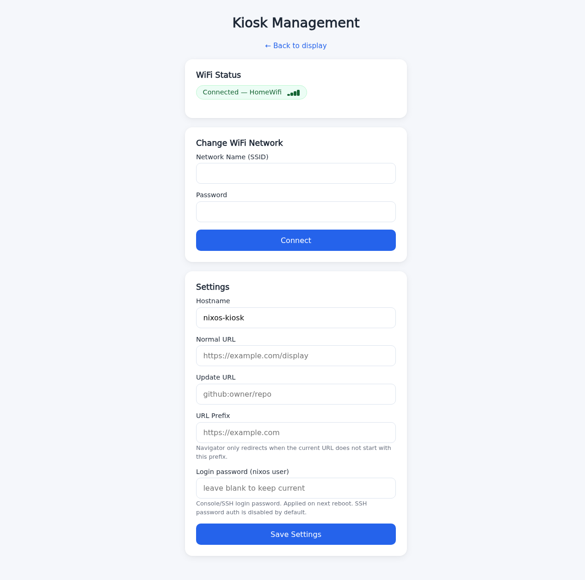

# NixOS Kiosk

**Create a Kiosk appliance with NixOS.**

This repo provides a few NixOS module to create an appliance kiosk.
It does not provide a full working system, it should be used
in a full-fledged NixOS configuration. See the [examples](examples/)
for integration examples.

Currently, it is tested exclusively for Raspberry Pi 3
with [github:ibizaman/nixos-raspberrypi](https://github.com/nvmd/nixos-raspberrypi). So usage with other systems might not work out of the box.
Feel free to open issues!

## NixOS VM tests

The best guarantee I have to offer is most if not all of the features presented here
have [NixOS VM tests](./app/tests).
As much as possible, I tried to avoid mocking any real component:

- [`vwifi`](https://github.com/Raizo62/vwifi) is used to create real WiFi devices tunnelled over TCP between VMs. NetworkManager, `wpa_supplicant` and the AP/client handshake use real `wlan` devices.
- `socat TCP-LISTEN:443` on the AP gateway VM creates a fake internet endpoint, so the daemon's TCP connectivity check passes without mocks.
- Use of `mac80211_hwsim` to provide a virtual WiFi radio on nodes that need a WiFi device but no actual network traffic (like for the firstboot test).

Also, the [screenshots](./docs/screenshots) and [kiosk.conf](./docs/kiosk.conf) files
are generated and verified in CI so they will never drift.

## Features

Each feature can be imported individually with modules.

- [Appliance module](#appliance): disables unneeded features.
- [Wifi module](#wifi): allow to setup WiFi connection at runtime.
- [Firstboot module](#first-boot-config): allow to configure some options without rebuilding the SD card.

### Appliance

Disables unneeded features on the host to reduce attack surface and disk and memory usage.

```nix
{
  imports = [ inputs.nixos-kiosk.nixosModules.appliance ];
}
```

- Disables nix on the host.
- Disables rebuilding the host.
- Users are static.
- Disables documentation.
- Removes Perl from default packages.

Options provided by this module:

- `kiosk.screenRotation` (`none`/`CW`/`CCW`): rotates the kernel console (`fbcon`), Wayland output (`wlr-randr`), and touchscreen input coordinates. `CW` = 90° clockwise, `CCW` = 90° counter-clockwise. On Raspberry Pi, additionally set `hardware.raspberry-pi.config.all.options.display_rotate` to cover GRUB.
- `kiosk.sshAuthorizedKeys`: list of SSH public keys baked into the image for the `nixos` user; password authentication is disabled by default. A key can also be provisioned without rebuilding via `ssh_authorized_key` in `kiosk.conf`.

Uses [nixpkgs' image-based-appliance.nix profile](https://github.com/NixOS/nixpkgs/blob/master/nixos/modules/profiles/image-based-appliance.nix) under the hood.

### WiFi

Let's you setup the WiFi connection at runtime, after boot.

```nix
{
  imports = [ inputs.nixos-kiosk.nixosModules.wifi-setup ];
}
```

When no WiFi is configured the device acts as an access point and
displays a setup form where you can enter your network credentials.

Either configure the WiFi from the interface or use the QR Code
to connect your mobile device to the Access Point of the device
and configure it from there.



Upon WiFi connection, the device will auto-switch to display
a configured hardcoded URL.

The WiFi is still configurable even if the device is connected:



### First Boot Config

Let's you setup options after burning an image on an SD card.

```nix
{
  imports = [ inputs.nixos-kiosk.nixosModules.firstboot ];

  config = {
    kiosk.firstboot.enable = true;
  };
}
```

Enabling this module generates a file `/boot/firmware/kiosk.conf`
which you can tweak to configure the appliance before booting it
for the first time.

The default `kiosk.conf` file can be seen in [docs/kiosk.conf](docs/kiosk.conf).

## Usage

Follow the flakes in the examples/ folder.
See their respective README.md files for build commands.

## Develop

### Push to cachix

nix build .#nixosConfigurations.nixos-kiosk-rpi3.config.system.build.toplevel --no-link --print-out-paths | grep -v .zst- | nix run nixpkgs#cachix push ibizaman
nix build .#sdImages.nixos-kiosk-rpi3 --no-link --print-out-paths | grep -v .zst- | nix run nixpkgs#cachix push ibizaman
